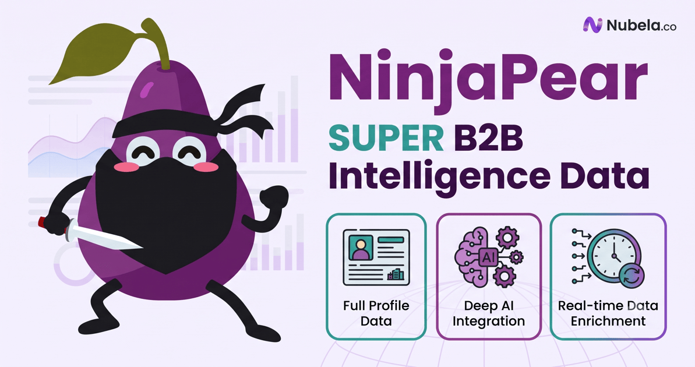
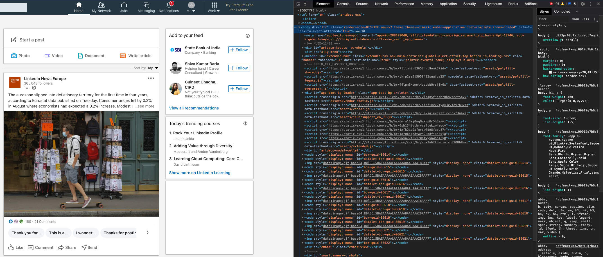
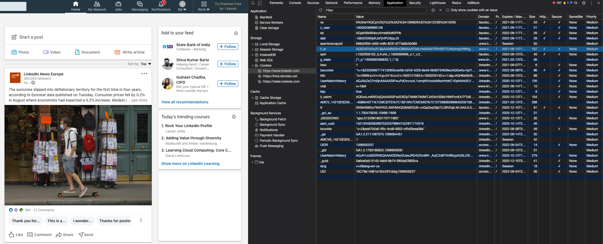
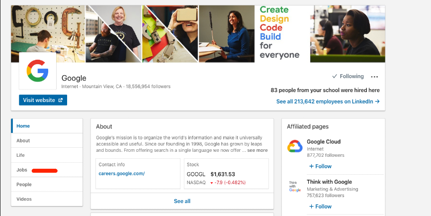
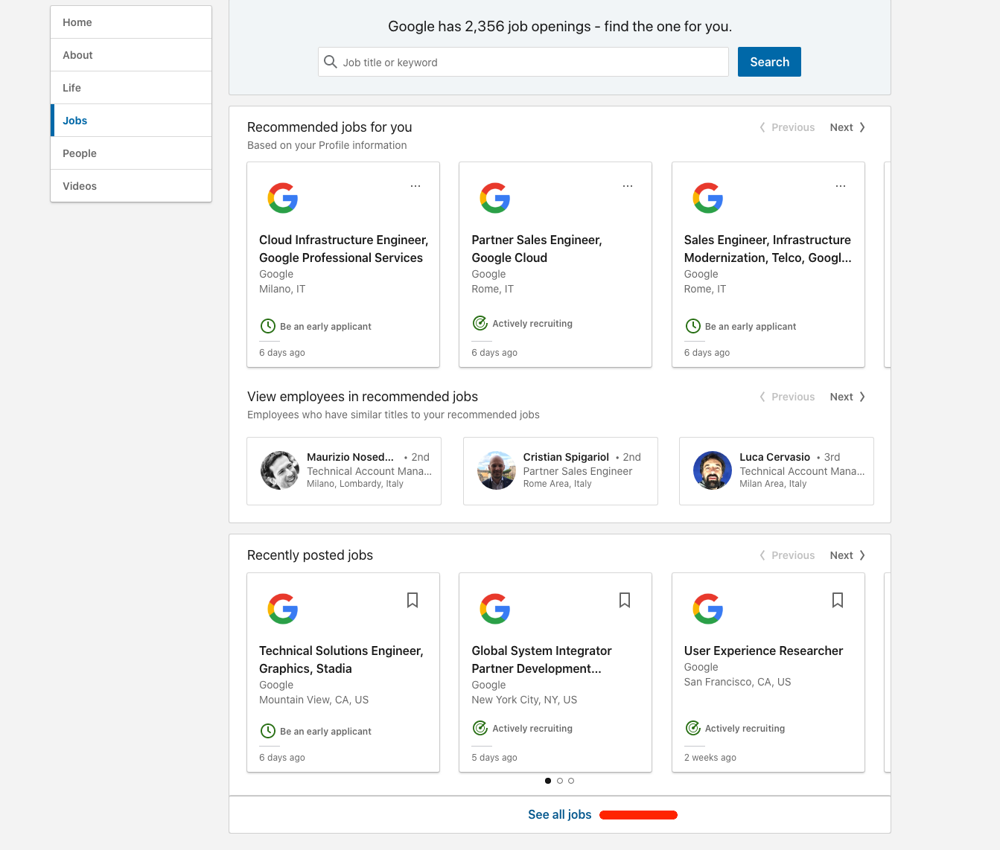

# linkedin-jobs-scraper
> Scrape public available jobs on Linkedin using headless browser.

* 🔑 **Session management**: long running session with auto recovery
* 🐢 **Adaptive rate limiting**: auto adjust scraping speed to avoid rate limiting
* 📄 **Fields parser**: `job_id`, `link`, `apply_link`, `title`, `company`, `company_link`, `company_employee_count`, `company_img_link`, `place`, `description`, `description_html`, `date`, `date_text`, `insights`, `salary`, `is_easy_apply`, `applicant_count`, `benefits`, `reposted`
* 🔍 **Filters**: date posted, employment type, experience level, workplace type, Easy Apply, under 10 applicants, verified, company
* 📡 **Events hooks**: data, metrics, errors
* 🚀 **Headless support**: can run in background
* ⌨️ **Command line interface**: scrape straight from your shell, no code required
* 🐍 **Programmatic API**: drive it from Python with full control

> [!WARNING]
> For personal or educational use only. All extracted data is publicly available on LinkedIn and remains
> owned by LinkedIn. I am not responsible for any inappropriate use of data extracted through this library.

## Sponsored by

<table>
<tr>
<td width="50%" valign="top">
<h3><a href="https://nubela.co/?utm_source=github&utm_medium=sponsorship&utm_campaign=oss_sponsorships&utm_content=github_readme&utm_id=py-linkedin-jobs-scraper">NinjaPear</a></h3>
<a id="sponsor-link" href="https://nubela.co/?utm_source=github&utm_medium=sponsorship&utm_campaign=oss_sponsorships&utm_content=github_readme&utm_id=py-linkedin-jobs-scraper" target="_blank"></a>
<p>Scrape+Enrich rich B2B profile data in real-time.</p>
</td>
<td width="50%" valign="top">
<h3><a href="https://proxy-seller.com/?utm_source=github&utm_medium=readme&utm_campaign=py-linkedin-jobs-scraper">Proxy-Seller</a></h3>
<a id="sponsor-link-proxyseller" href="https://proxy-seller.com/?utm_source=github&utm_medium=readme&utm_campaign=py-linkedin-jobs-scraper" target="_blank"></a>
<p>Proxy-Seller gives you reliable proxy infrastructure for any workflow: private residential, mobile (4G/5G/LTE), ISP, and datacenter IPv4/IPv6 proxies, all with HTTP(S) and SOCKS5 support. Tap into 47M+ residential IPs across 220+ locations, target exactly the country, city, or ISP you need, and count on 99.7% uptime backed by 24/7 support. Get 15% off with promo code <code>LKDJOBS</code>.</p>
</td>
</tr>
</table>

## Table of Contents

<!-- toc -->

* [Requirements](#requirements)
* [Installation](#installation)
* [Usage](#usage)
  * [CLI](#cli)
  * [Programmatic](#programmatic)
  * [Pinning a location by geoId](#pinning-a-location-by-geoid)
* [Authentication](#authentication)
* [Adaptive Rate limiting](#adaptive-rate-limiting)
* [Filters](#filters)
* [Company filter](#company-filter)
* [Logging](#logging)
* [License](#license)

<!-- toc stop -->


## Requirements
- [Chrome](https://www.google.com/intl/en_us/chrome/) or [Chromium](https://www.chromium.org/getting-involved/download-chromium)
- Python >= 3.10

A Chromedriver matching your installed Chrome (or the binary passed as `chrome_binary_location`)
is resolved automatically through Selenium Manager and cached in `~/.cache/selenium`; <u>any
chromedriver on your `PATH` is ignored</u>. 
<br>To use a specific chromedriver instead, pass it explicitly
(`--chrome-executable-path` on the CLI):

```python
scraper = LinkedinScraper(
    chrome_executable_path='/path/to/chromedriver',
    chrome_binary_location='/path/to/chrome',
)
```


## Installation
Install package:
```shell
pip install linkedin-jobs-scraper
```


## Usage

Both a command line interface and a Python API are supported. Before your first scrape you need to authenticate once. The quickest way is the CLI:

```shell script
lijs login
```

This signs in once into the default Chrome profile, `~/.lijs/chrome-profile`, which later runs pick
up on their own. See [Authentication](#authentication) for all the options (Chrome profile, cookie
pair, headless machines) and how the scraper chooses between them.

### CLI

Installing the package also installs a command line interface. It mirrors the programmatic API but
scrapes a single query per invocation (there is no `max_workers` or `chrome_options` on the CLI).

Two equivalent commands are installed:

```shell script
linkedin-jobs-scraper --help   # full command
lijs --help                    # short alias
```

The package is also runnable as a module:

```shell script
python -m linkedin_jobs_scraper --help
```

#### Subcommands

#### `jobs`
Search jobs matching the provided query, locations and filters:

```shell script
lijs jobs "software engineer" --location "United States" --location "Remote" --limit 50
lijs jobs "data scientist" --geo-id 103644278 --time week --type full-time,contract \
  --experience senior --workplace remote,hybrid --verified --apply-link --chrome-profile <path>
```

- Positional `query` — the search keywords. Required: LinkedIn shows no results for a search
  without keywords, so an empty query is refused.
- `--location NAME` (repeatable) or `--geo-id ID` (repeatable) — mutually exclusive. A name is
  resolved to a geoId through LinkedIn's location picker; a numeric `--location` is taken as a
  geoId directly (see [Locations](#pinning-a-location-by-geoid)). Without either, the account's
  current location is searched; `Worldwide` is not available on LinkedIn's search and is skipped.
- `--limit N` — maximum jobs to scrape, `0` for unlimited (default `25`).
- `--apply-link` — resolve the external apply link for each job (slower).
- `--skip-promoted-jobs` — skip promoted jobs.
- `--page-offset N` — number of result pages to skip (default `0`).

Filters use kebab-case values. Single-valued: `--time {any,day,week,month}`, and one of
`--company-jobs-url URL` or `--company-id ID` (a company search still needs a query). Repeatable or comma-separated: `--type`
(`full-time`, `part-time`, `contract`, `internship`, `volunteer`), `--experience`
(`entry-level`, `senior`, `manager`, `director`, `executive`), `--workplace` (`on-site`,
`remote`, `hybrid`). Boolean toggles: `--easy-apply` (only LinkedIn Easy Apply jobs),
`--under-10-applicants` (only jobs with fewer than 10 applicants), `--verified` (only verified
jobs). Run `lijs jobs --help` for the full list of values. See [Filters](#filters) for the
filters LinkedIn no longer supports.

#### `job`
Lookup a single job id or a `/jobs/view/<id>` url, with an optional `--apply-link`:

```shell script
lijs job 3690634839
lijs job https://www.linkedin.com/jobs/view/3690634839 --apply-link
```

#### `login`

```shell script
lijs login                                  # default profile, ~/.lijs/chrome-profile
lijs login --chrome-profile ~/work-profile  # any other profile
```

Opens a visible browser to sign in once into a reusable Chrome profile, then prints the cookie pair
ready to export. `--chrome-profile` (alias `--chrome-user-data-dir`) defaults to
`~/.lijs/chrome-profile`; a missing profile directory is created readable by its owner only, and
removed again if the sign in fails, times out, the browser is closed or the command is interrupted
(a directory that already existed is never removed). Also accepts `--chrome-executable-path` and
`--chrome-binary-location`.

#### Driver flags

Shared by `jobs` and `job`: `--no-headless`, `--slow-mo SECONDS`, `--no-adaptive-slow-mo`,
`--page-load-timeout SECONDS`, `--chrome-executable-path PATH`, `--chrome-binary-location PATH`,
`--chrome-profile DIR`, `--interactive-login`. Without `--chrome-profile`, the session comes from the
cookie environment variables, or from `~/.lijs/chrome-profile` when none is set (see
[Authentication](#authentication)).

#### Output

DATA is written to **stdout**; progress, metrics and errors go to **stderr**, so piping the data
stream stays clean.

- `-f`, `--out-format {table,jsonl,json,csv}` — output format.
- `-o`, `--out-path PATH` — destination; `-` means stdout.
- `--fields a,b,c` — comma-separated list of fields to emit.
- `--all-fields` — emit every available field.
- `--vertical` — render one field per line.
- `--raw` — emit the raw record unformatted.

When `--out-format` is omitted the format is inferred from the `--out-path` extension (`.csv`,
`.json`, `.jsonl`); with no path it defaults to `table` on a TTY and `jsonl` when piped or written
to a file.

In the `table` format on a TTY, URL fields are rendered as clickable terminal hyperlinks (OSC 8):
columns show a compact label (host and last path segment) while clicking opens the full URL.
Structured formats (`jsonl`/`json`/`csv`) always carry the full, unmodified URLs.

In the `table` format on a TTY, cell values are colour-coded per column (`title`, `company`,
`place`, `date`, `link`) to make rows easier to scan; `--no-color` (or the `NO_COLOR` environment
variable) disables it.

#### Global flags

`--quiet`, `-v`/`-vv` (repeatable, increases verbosity), `--no-color`, `--version`. `--no-color` is
accepted on every subcommand, before or after it.

#### Exit codes

| Code | Meaning |
| --- | --- |
| `0` | Success |
| `1` | Generic error |
| `2` | Invalid session: the Chrome profile is missing or empty, no usable session in the profile or from the cookies, or LinkedIn refused it |
| `3` | Job not found (`job`) |
| `130` | `login` interrupted with Ctrl-C |

### Programmatic

```python
import logging
from linkedin_jobs_scraper import LinkedinScraper
from linkedin_jobs_scraper.events import Events, EventData, EventMetrics, EventBegin
from linkedin_jobs_scraper.query import Query, QueryOptions, QueryFilters, Location
from linkedin_jobs_scraper.filters import TimeFilters, TypeFilters, ExperienceLevelFilters, OnSiteOrRemoteFilters

# Change root logger level (default is WARN)
logging.basicConfig(level=logging.INFO)


# Fired once per query/location before scraping starts, carrying LinkedIn's total result
# count (total is None when it could not be read, a lower bound when total_capped is True)
def on_begin(data: EventBegin):
    print('[ON_BEGIN]', data.location, data.resolved_location, data.total, data.total_capped)


# Fired once for each successfully processed job
def on_data(data: EventData):
    print('[ON_DATA]', data.title, data.company, data.company_link, data.date, data.date_text, data.link, data.insights,
          len(data.description))


# Fired once for each page (25 jobs)
def on_metrics(metrics: EventMetrics):
    print('[ON_METRICS]', str(metrics))


def on_error(error):
    print('[ON_ERROR]', error)


def on_end():
    print('[ON_END]')


scraper = LinkedinScraper(
    chrome_executable_path=None,  # Custom chromedriver path (e.g. /foo/bar/bin/chromedriver), used as given; None resolves one matching Chrome
    chrome_binary_location=None,  # Custom path to Chrome/Chromium binary (e.g. /foo/bar/chrome-mac/Chromium.app/Contents/MacOS/Chromium)
    chrome_options=None,  # Custom Chrome options here
    headless=True,  # Overrides headless mode only if chrome_options is None
    max_workers=1,  # How many threads will be spawned to run queries concurrently (one Chrome driver for each thread)
    slow_mo=0.8,  # Minimum seconds slept between jobs, to avoid 'Too many requests 429' errors. Minimum 0.2, default 0.8
    adaptive_slow_mo=True,  # Slow down automatically when Linkedin throttles the run, then ease back. See 'Rate limiting'
    page_load_timeout=40,  # Page load timeout (in seconds)
    chrome_user_data_dir=None,  # Chrome profile reused across runs; None means cookie env vars, else ~/.lijs/chrome-profile. See 'Authentication'
    interactive_login=False  # Sign in by hand on the first run, when the profile holds no session. Requires a display
)

# Add event listeners
scraper.on(Events.BEGIN, on_begin)
scraper.on(Events.DATA, on_data)
scraper.on(Events.ERROR, on_error)
scraper.on(Events.END, on_end)

queries = [
    Query(
        options=QueryOptions(
            limit=27  # Limit the number of jobs to scrape. Use 0 to scrape all available jobs (LinkedIn serves up to ~1000).
        )
    ),
    Query(
        query='Engineer',
        options=QueryOptions(
            locations=['Europe', Location(geo_id='103644278', name='United States')],  # Plain name, or pin a geo by geoId. See 'Pinning a location by geoId'
            apply_link=True,  # Try to extract apply link (easy applies are skipped). If set to True, scraping is slower because an additional page must be navigated. Default to False.
            skip_promoted_jobs=True,  # Skip promoted jobs. Default to False.
            page_offset=2,  # How many pages to skip
            limit=5,
            filters=QueryFilters(
                company_jobs_url='https://www.linkedin.com/jobs/search/?f_C=1441%2C17876832%2C791962%2C2374003%2C18950635%2C16140%2C10440912&geoId=92000000',  # Filter by companies.
                time=TimeFilters.MONTH,
                type=[TypeFilters.FULL_TIME, TypeFilters.INTERNSHIP],
                on_site_or_remote=[OnSiteOrRemoteFilters.REMOTE],
                experience=[ExperienceLevelFilters.SENIOR],
                verified=True,
            )
        )
    ),
]

scraper.run(queries)
```

#### Additional `EventData` fields

Alongside the core fields, each `EventData` also carries:

* `resolved_location`: the location LinkedIn actually applied to the search, as the page's location control names it (e.g. `'San Francisco Bay Area'` for `'San Franci'`, or the account's current location when none was given). `''` when it could not be read, and always `''` for a single job.
* `description`, `description_html`: the posting's text and markup from the "About the job" section.
* `date_text`: the relative date as LinkedIn shows it on the job's top line (e.g. `'Reposted 5 days ago'`, `'3 hours ago'`), otherwise `''`.
* `salary`: the pay range pill (e.g. `'30K EUR/yr - 50K EUR/yr'`) when LinkedIn shows one, otherwise `''`.
* `insights`: the job's other pills, such as workplace and employment type (e.g. `['Hybrid', 'Full-time']`).
* `is_easy_apply`: `True` when the listing uses LinkedIn Easy Apply, `False` for an external apply flow.
* `apply_link`: with `apply_link=True`, the off-LinkedIn application URL of an external job; always `''` for Easy Apply.
* `applicant_count`: whichever applicant text the top line shows, `'N applicants'` or `'… people clicked apply'` (e.g. `'Over 100 people clicked apply'`), otherwise `''`.
* `benefits`: the benefit names on the search result card's benefits pill (e.g. `['Medical', 'Vision', 'Dental']`). A `+N benefit(s)` remainder is dropped and a count-only pill (`'9 benefits'`) gives `[]`, so the list may be incomplete. Always `[]` for a single job, which has no card.
* `reposted`: `True` when the top line marks the listing as reposted.
* `company_link`, `company_employee_count`: the company's LinkedIn page and its size (e.g. `'201-500 employees'`) from the "About the company" section.

`date` is an ISO `YYYY-MM-DD` string approximated from `date_text` at the precision it gives
(minutes and hours resolve to today; weeks, months and years are approximated at 7, 30 and 365
days), and is `''` only when no date text could be parsed. It is only as accurate as that text:
a `'4 months ago'` posting gets a date accurate to the month, not the day.

#### Scraping a single job

When you already know the job you want, `scrape_job` fetches it directly by url or id, bypassing
search and pagination. It accepts a bare numeric id or a full `/jobs/view/<id>` url, emits a single
`Events.DATA` event on success, and `Events.ERROR` (without raising) on failure. A dead or expired
id, one that points to a job that no longer exists, emits `Events.NOT_FOUND` (carrying an
`EventNotFound` with the `job_id`) rather than `Events.ERROR`, since a missing job is not a scraping
error.

```python
from linkedin_jobs_scraper import LinkedinScraper
from linkedin_jobs_scraper.events import Events, EventData, EventNotFound


def on_data(data: EventData):
    print('[ON_DATA]', data.title, data.company, data.company_link, data.date_text, data.link,
          data.insights, len(data.description))


def on_error(error):
    print('[ON_ERROR]', error)


def on_not_found(data: EventNotFound):
    print('[ON_NOT_FOUND]', data.job_id)


scraper = LinkedinScraper(
    headless=True,
    max_workers=1,
    slow_mo=0.8,
)

scraper.on(Events.DATA, on_data)
scraper.on(Events.ERROR, on_error)
scraper.on(Events.NOT_FOUND, on_not_found)

# By bare id
scraper.scrape_job('4455383771')

# Or by full url
scraper.scrape_job('https://www.linkedin.com/jobs/view/4455383771/')

# Pass apply_link=True to also extract the external apply link (slower)
scraper.scrape_job('4455383771', apply_link=True)
```

The single-job path opens the job's `/jobs/view/<id>/` page and reads the same detail sections a
search does, so it fills the same fields with one exception: `benefits` is always `[]`, since it
comes from the search result card. `place` is the top line's full place (e.g. `'Milan, Lombardy,
Italy'`) rather than the card's shorter one. `query`, `location`, `resolved_location` are empty and `job_index` is `-1`,
as there is no search context.

### Pinning a location by geoId

A location entry can be a plain string or a `Location` that pins the geo through LinkedIn's own
`geoId`:

```python
from linkedin_jobs_scraper.query import Location

Location(geo_id='103644278', name='United States')
```

LinkedIn ignores a free-text location, so a location is sent as a `geoId`:

- A `Location` is used as given. `name` is only a human label for logs and
  `EventData.location`, and can be left out (the `geo_id` is then used as the label).
- A numeric string (`'103644278'`) is taken as a geoId.
- No location (`''`, or no `locations` at all) sends no `geoId`, and LinkedIn searches the
  account's current location: the one it remembers from the account's last search.
- `'Worldwide'` is warned and skipped. LinkedIn's search page no longer offers a worldwide search:
  every way of asking for one leaves the account's current location applied.
- Any other string (`'Germany'`, `'San Francisco Bay Area'`) is typed into the location picker of
  LinkedIn's search page, and the `geoId` of LinkedIn's first suggestion is used. The match is
  logged at `INFO` (`Location 'Germany' resolved to 'Germany' (geoId 101282230)`), so check it
  when a name is ambiguous. Each name is looked up once per process. A name LinkedIn has no
  suggestion for is reported with a warning and that location is skipped; the other locations of
  the run still scrape.

LinkedIn remembers the last searched location per account, so a run leaves the account's current
location at the last one it searched, and a later search without a location inherits it.

After the first results page opens, the location LinkedIn applied is read from the page and
reported as `resolved_location` on `EventBegin` and every `EventData` of that location. LinkedIn
occasionally ignores a `geoId`, so when a name was resolved through the picker, the applied
location is compared with the picker's match on its first comma-separated segment (`'Rome,
Latium, Italy'` matches `'Rome'`). On a mismatch the page is re-opened once, and if LinkedIn still
applies another location, that location is warned and skipped. A `Location` or a numeric geoId
is not checked.

To find a `geoId` yourself, run the search on LinkedIn in a browser, then read the `geoId=` value
from the URL.

## Authentication

The scraper needs a LinkedIn session. The **recommended and tested** way is a Chrome profile on a local machine (see below). The cookie-based modes are supported alternatives, but LinkedIn may refuse them in some environments (for example CI or a server), so they are not guaranteed everywhere. All modes keep the session alive on their own, so a long run is not interrupted when LinkedIn expires it.

|  | Chrome profile (recommended) | Cookie pair |
| --- | --- | --- |
| Runs on | A machine with a display | No display needed (may be refused in some environments) |
| Setup | Sign in once, in a browser window | Two environment variables |
| Lasts | As long as the profile is kept | About a year |
| Concurrency | `max_workers` forced to `1` | Unrestricted |

The CLI and the library pick the session source for a run in this order:

1. **An explicit Chrome profile**: `--chrome-profile` / `chrome_user_data_dir=`, or a
   `--user-data-dir` argument in your own `chrome_options`.
2. **Cookie environment variables**: `LI_RM_COOKIE` with `LI_BCOOKIE`, or `LI_AT_COOKIE`. Each
   browser gets a throwaway profile.
3. **The default Chrome profile**, `~/.lijs/chrome-profile`. It is created by `lijs login` (or
   `linkedin_jobs_scraper.login.sign_in()`), never by a scrape: a scrape that falls back on it
   while it does not exist, or is empty, stops before any browser opens, with an error asking you
   to sign in.

Each run logs the source it uses at `INFO` level, for example
`Session source: Chrome profile ~/.lijs/chrome-profile (default)`; the CLI also shows it on the
`session` line of the summary it prints before a run.

An explicit profile that does not exist or is empty is refused the same way when no cookie
environment variable is set to seed it. Either refusal, and a profile that exists but holds no
usable session (for example an expired one), makes the run emit `INVALID_SESSION` and raise
`InvalidCookieException`; `lijs jobs` and `lijs job` print the reason as one `❌ error: ...` line and exit
with code `2`.

### 1. Chrome profile

Sign in once into a Chrome profile that the scraper then reuses:

```shell script
lijs login
```

This uses the default profile `~/.lijs/chrome-profile`, created readable by its owner only;
pass `--chrome-profile <path>` to sign in to another one.

A browser window opens on the sign in page. Sign in there, ticking **"Keep me logged in"** — that
is what makes the profile reusable. The password is typed into the browser: nothing in this
package reads, stores or transmits it.

With no cookie environment variables set, the scraper picks up the default profile by itself;
any other profile is passed explicitly:

```python
scraper = LinkedinScraper()  # ~/.lijs/chrome-profile
scraper = LinkedinScraper(chrome_user_data_dir='~/work-profile')
```

To skip the separate command and have the first run do the sign in instead:

```python
scraper = LinkedinScraper(interactive_login=True)
```

`interactive_login` requires a Chrome profile, explicit or default, and waits up to 10 minutes for a
human, so leave it off (the default) anywhere nobody is watching, such as CI or a server. Chrome
locks a profile directory, so `max_workers` is forced to `1` whenever the run uses a Chrome profile,
explicit or default.

### 2. Cookie pair

You can use LinkedIn's remember me cookies (`li_rm` and `bcookie`) as environment variables to obtain a session, an option when a browser window is not available (you still need a machine with a browser window to obtain them the first time). Both variables are required. LinkedIn may refuse this mode in some environments (for example CI), so it is not guaranteed everywhere; prefer the Chrome profile when you can.

```shell script
export LI_RM_COOKIE='<li_rm value>'
export LI_BCOOKIE='<bcookie value>' # keep the double quote " characters the value contains
python your_app.py
```

Get the two values by running the sign in command above on a machine that has a display: it
prints them at the end, quoted and ready to export.

> [!WARNING]
> Do not copy these two cookies out of your browser's developer tools:
> use the sign in command described above instead.

Setting `chrome_user_data_dir` as well is worth it if the host has storage that survives across runs:
the session is then reused instead of being requested again at the start of each run.

### Fallback: a bare session cookie

`LI_AT_COOKIE` takes the `li_at` session cookie on its own. This one can be copied straight out of your own Chrome browser. Sign in, then open Chrome developer
tools:



Go to tab `Application`, then from the left panel select `Storage` -> `Cookies` ->
`https://www.linkedin.com`, locate the row named `li_at` and copy the `Value` column.



```shell script
LI_AT_COOKIE=<your li_at cookie value here> python your_app.py
```

This cookie cannot be renewed: LinkedIn expires it after a while, and a run that
loses it stops. Expect to replace it by hand. As with the cookie pair, LinkedIn may refuse it in some environments; prefer the Chrome profile when you can.

### Begin event

`BEGIN` fires once per query/location, before any job is scraped, carrying an `EventBegin` with
LinkedIn's total result count for that search. `total` is `None` when the count could not be
read, and `total_capped` is `True` when LinkedIn shows a capped count such as "99+ results", in
which case `total` is a lower bound. `location` is the location that search was asked for and
`resolved_location` the one LinkedIn applied, both as on `EventData`. A location that is skipped
(no match, `'Worldwide'`, a mismatch) fires no `BEGIN`, so tell the sections apart by `location`,
not by their order. Combined with `limit=0` (scrape all available jobs, LinkedIn serves up to
~1000), it lets a caller know upfront roughly how many results a query has:

```python
from linkedin_jobs_scraper.events import Events, EventBegin

def on_begin(data: EventBegin):
    print('total results reported by LinkedIn:', data.total, '+' if data.total_capped else '')

scraper.on(Events.BEGIN, on_begin)
```

### Session events

`SESSION_REFRESHED` fires whenever the scraper ends up holding a session cookie different from
the one it was given. Listen to it if you have nowhere else to store a session and want to reuse
it on the next run:

```python
from linkedin_jobs_scraper.events import Events, EventSession

def on_session_refreshed(session: EventSession):
    print('store this for the next run:', session.li_at)

scraper.on(Events.SESSION_REFRESHED, on_session_refreshed)
```

`INVALID_SESSION` fires when no usable session is available - the Chrome profile is missing or
empty with no cookie to seed it (checked before any browser opens), the profile holds none and no
credential could establish one, or every credential supplied was refused - immediately before the
run aborts with `InvalidCookieException`. It takes no arguments:

```python
def on_invalid_session():
    print('LinkedIn refused every credential')

scraper.on(Events.INVALID_SESSION, on_invalid_session)
```

> [!NOTE]
> **Changed in 6.0.0:** `INVALID_SESSION` used to fire whenever a session cookie went missing,
> which normally happened right before a new one was issued and the run carried on. It now fires
> only when authentication has actually failed. If you were using it to know when to harvest a
> fresh cookie, use `SESSION_REFRESHED` instead.

### Not found event

`NOT_FOUND` (`scraper:not-found`) fires when a single-job scrape (`scrape_job`) targets a job that
does not exist or is no longer available. It carries an `EventNotFound` with the `job_id` that was
requested. Throttling and page-load failures stay a silent skip, since neither says anything about
whether the job exists:

```python
from linkedin_jobs_scraper.events import Events, EventNotFound

def on_not_found(data: EventNotFound):
    print('job no longer available:', data.job_id)

scraper.on(Events.NOT_FOUND, on_not_found)
```

## Adaptive Rate limiting

Requests failing with the status code 429 mean you are sending too many requests and Linkedin is
throttling them. Two parameters control this:

- `slow_mo`: seconds slept between jobs. Higher is safer, at least `0.2`, default `0.8`.
- `max_workers`: how many queries run concurrently. Default and recommended `1`.

`slow_mo` sets the fastest the run will ever go, not a fixed delay: with `adaptive_slow_mo` on
(the default) the run starts at that speed and slows itself down whenever Linkedin pushes back.

- **On every 429**, the delay between jobs doubles, up to `min(10, slow_mo * 10)` seconds.
- **After 20 jobs in a row without a 429**, the delay shrinks back towards `slow_mo`, and never
  goes below it.
- **When a whole page is throttled**, the scraper waits and asks for it again: first 5s, then
  15s, then 45s. A short burst of throttling no longer ends the query.

Pass `adaptive_slow_mo=False` to make `slow_mo` a fixed delay instead.

The `METRICS` event reports both numbers:

- `throttled`: how many 429s the run has met.
- `pace`: the delay currently slept between jobs.

## Filters
It is possible to customize queries with the following filters:
- TIME (`time`, date posted):
    * `DAY`
    * `WEEK`
    * `MONTH`
    * `ANY`
- TYPE (`type`, employment type, one or more):
    * `FULL_TIME`
    * `PART_TIME`
    * `CONTRACT`
    * `INTERNSHIP`
    * `VOLUNTEER`
- EXPERIENCE LEVEL (`experience`, one or more):
    * `ENTRY_LEVEL`
    * `SENIOR`
    * `MANAGER`
    * `DIRECTOR`
    * `EXECUTIVE`
- ON SITE OR REMOTE (`on_site_or_remote`, workplace type, one or more):
    * `ON_SITE`
    * `REMOTE`
    * `HYBRID`
- EASY APPLY: `easy_apply=True` restricts results to jobs with LinkedIn Easy Apply.
- UNDER 10 APPLICANTS: `under_10_applicants=True` restricts results to jobs with fewer than 10 applicants.
- VERIFIED: `verified=True` restricts results to verified jobs.
- COMPANY: `company_id='1441'`, or `company_jobs_url` (see below). The two are mutually exclusive.
  A company search still needs keywords: LinkedIn answers one without keywords with its landing
  page of suggested searches, so `Query(query='')` is refused even with a company filter.

Several values of one filter match any of them; different filters must all match, as in
LinkedIn's own filter panel.

Not supported, because LinkedIn's current jobs page ignores them: sort order (`RelevanceFilters`),
base salary (`SalaryBaseFilters`), industry (`IndustryFilters`), job function
(`JobFunctionFilters`), benefits (`BenefitsFilters`) and commitments (`CommitmentsFilters`). They
were removed in 9.0.0, and passing them raises. The "In my network" filter is not implemented:
how LinkedIn encodes it could not be observed.

See the following example for more details:

```python
from linkedin_jobs_scraper.query import Query, QueryOptions, QueryFilters
from linkedin_jobs_scraper.filters import TimeFilters, TypeFilters, ExperienceLevelFilters, OnSiteOrRemoteFilters
query = Query(
    query='Engineer',
    options=QueryOptions(
        locations=['United States'],
        apply_link=True,
        skip_promoted_jobs=True,
        limit=5,
        filters=QueryFilters(
            time=TimeFilters.MONTH,
            type=[TypeFilters.FULL_TIME, TypeFilters.INTERNSHIP],
            experience=[ExperienceLevelFilters.ENTRY_LEVEL, ExperienceLevelFilters.SENIOR],
            on_site_or_remote=[OnSiteOrRemoteFilters.REMOTE, OnSiteOrRemoteFilters.HYBRID],
            easy_apply=True,
            under_10_applicants=True,
            verified=True,
        )
    )
)
```

### Company Filter

It is also possible to filter by company using the public company jobs url on LinkedIn. To find this url you have to:
 1. Login to LinkedIn using an account of your choice.
 2. Go to the LinkedIn page of the company you are interested in (e.g. [https://www.linkedin.com/company/google](https://www.linkedin.com/company/google)).
 3. Click on `jobs` from the left menu.
 
 

 
 4. Scroll down and locate `See all jobs` or `See jobs` button.
 
 
 
 5. Right click and copy link address (or navigate the link and copy it from the address bar).
 6. Paste the link address in code as follows:
 
```python
query = Query(
    query='Engineer',  # A search needs keywords
    options=QueryOptions(
        filters=QueryFilters(
            # Paste link below
            company_jobs_url='https://www.linkedin.com/jobs/search/?f_C=1441%2C17876832%2C791962%2C2374003%2C18950635%2C16140%2C10440912&geoId=92000000',        
        )
    )
)
```
  
## Logging
Package logger can be retrieved using namespace `li:scraper`. Default level is `INFO`. 
It is possible to change logger level using environment variable `LOG_LEVEL` or in code:

```python
import logging

# Change root logger level (default is WARN)
logging.basicConfig(level = logging.DEBUG)

# Change package logger level
logging.getLogger('li:scraper').setLevel(logging.DEBUG)

# Optional: change level to other loggers
logging.getLogger('urllib3').setLevel(logging.WARN)
logging.getLogger('selenium').setLevel(logging.WARN)
```

## License
[MIT License](http://en.wikipedia.org/wiki/MIT_License)

If you like the project and want to contribute you can [donate something here](https://paypal.me/spinlud)!
